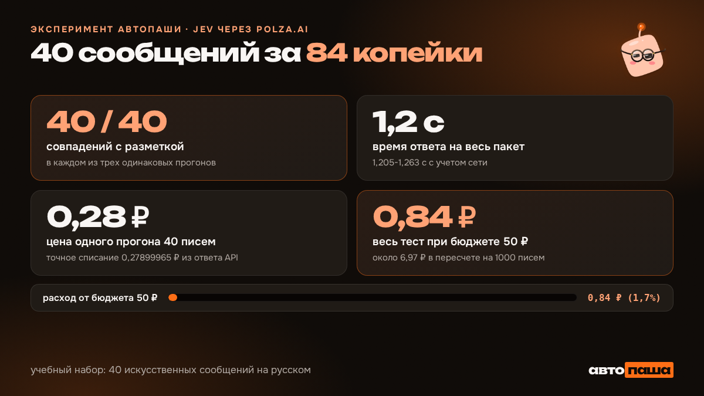
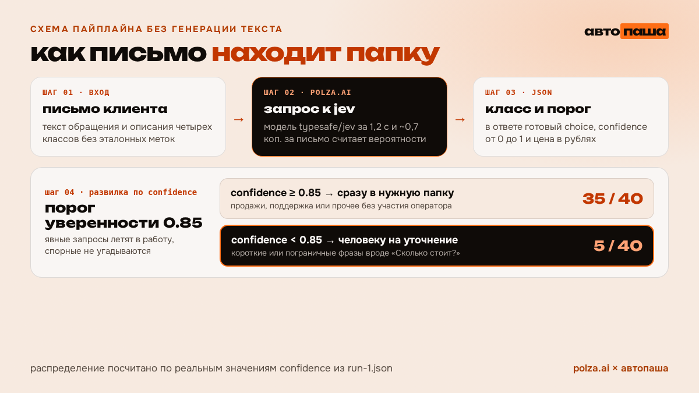
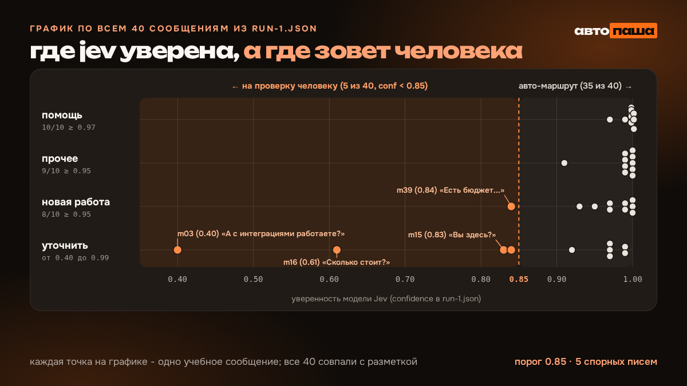
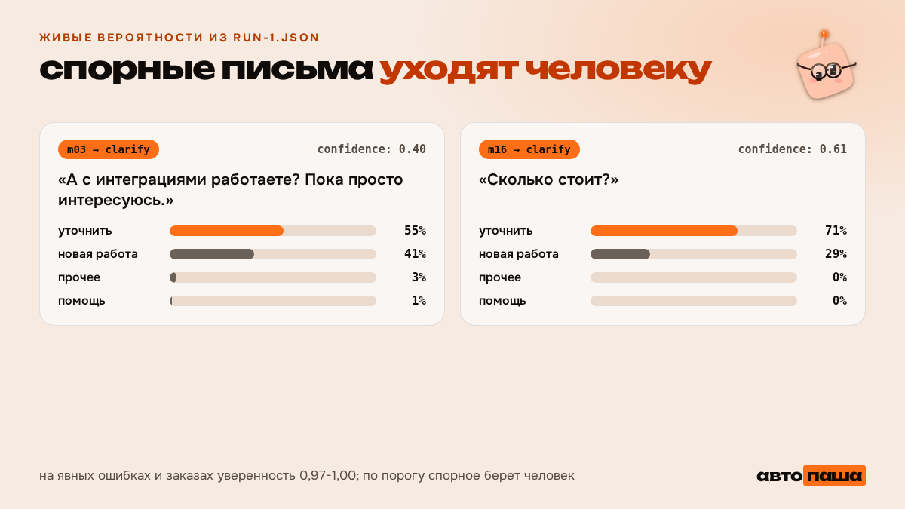
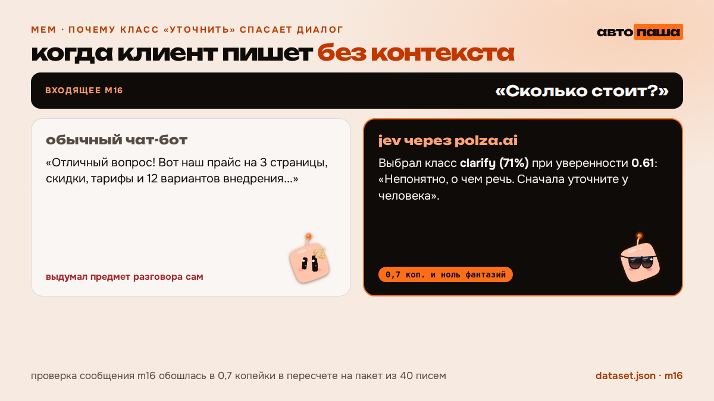
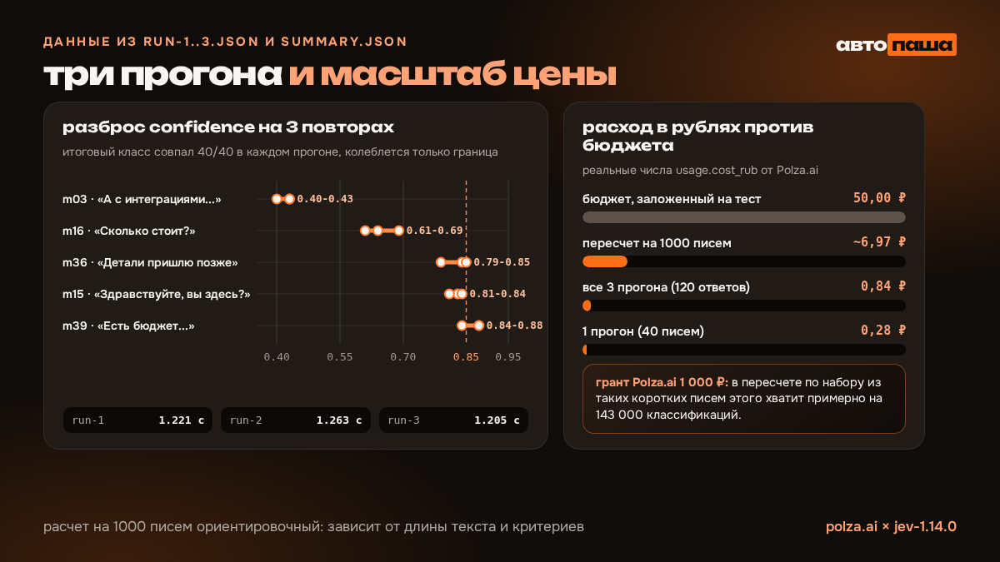
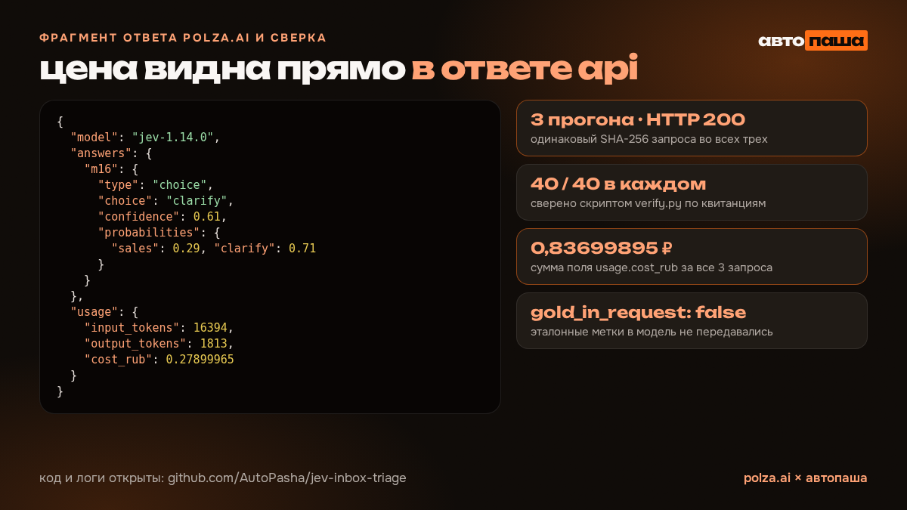
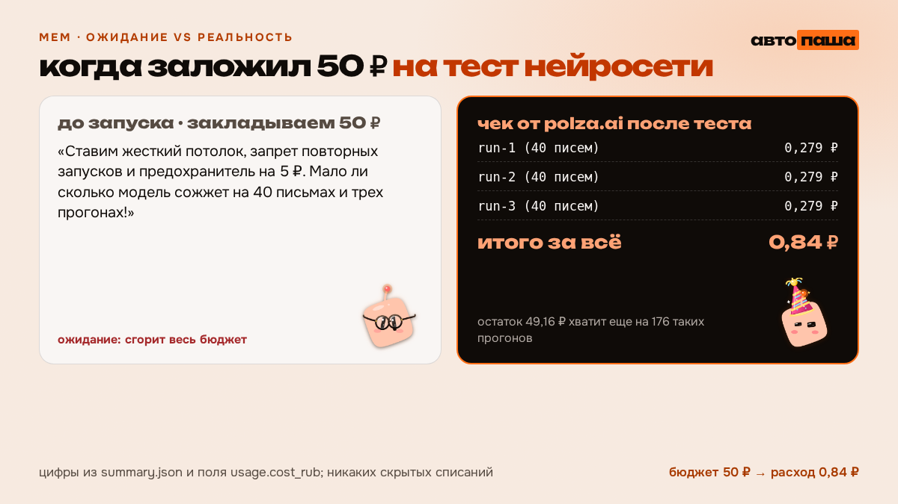
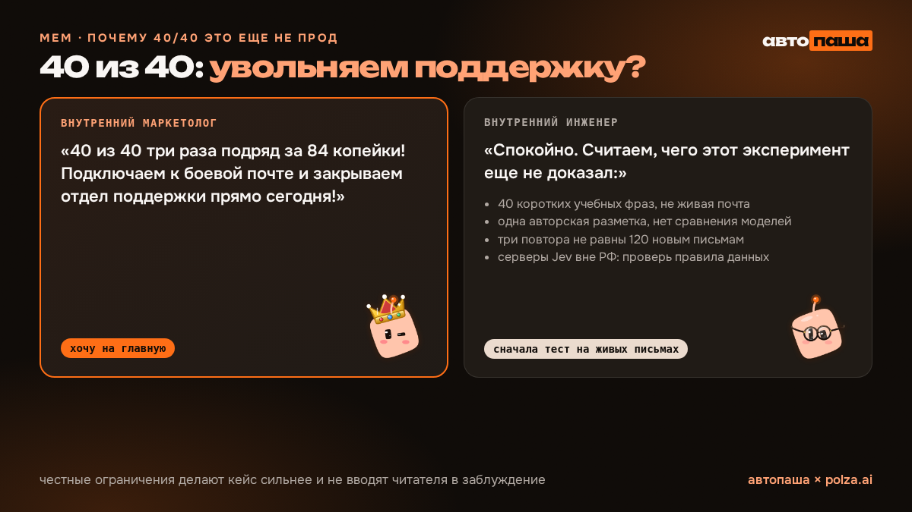

# Сортировка 40 обращений на Jev через Polza.ai за 84 копейки



В этом репозитории лежат все материалы эксперимента команды [АвтоПаши](https://autopasha.ru) по классификации входящих обращений с помощью модели `typesafe/jev`, подключенной через API [Polza.ai](https://polza.ai). Весь тест из трех прогонов на 40 русскоязычных сообщениях обошелся в 0,84 ₽ (0,83699895 ₽ по полю `usage.cost_rub`) при заложенном бюджете 50 ₽.

Обычно для разбора входящих писем берут большую языковую модель и просят ее вернуть JSON с названием категории. У `typesafe/jev` другой формат: на вход уходят тексты и описания классов, а на выход возвращается выбранная метка, уверенность `confidence` и распределение вероятностей по всем вариантам, так что модель ничего не сочиняет от себя.

## Схема сортировки и порог уверенности



Мы выделили четыре категории:

- `sales` (новая работа): человек хочет заказать разработку, дизайн или автоматизацию и описал потребность.
- `support` (помощь с продуктом): сообщение об ошибке в уже работающем решении или вопрос по подписке.
- `other` (прочее): чужая реклама, благодарность, обсуждение без запроса или отказ от покупки.
- `clarify` (требует уточнения): из фразы непонятно, чего именно хочет клиент, поэтому нужно задать встречный вопрос.

Если выставить порог уверенности на уровне `0.85`, 35 из 40 сообщений из нашего набора сразу уходят в нужную папку, а оставшиеся 5 пограничных писем передаются человеку, чтобы робот не гадал наугад.

## График уверенности по всем 40 сообщениям



На явных заявках и сообщениях об ошибках модель ставит уверенность `0.97-1.00`, а на коротких или двусмысленных фразах честно снижает оценку. Например, сообщение `m03` («А с интеграциями работаете? Пока просто интересуюсь.») получило `confidence: 0.40` (55% за `clarify` и 41% за `sales`), а голое «Сколько стоит?» (`m16`) прошло с `confidence: 0.61` (71% за `clarify` против 29% за `sales`).





## Три прогона, повторяемость и стоимость

Чтобы проверить стабильность ответа и увидеть точное списание в рублях, мы отправили один и тот же пакет из 40 сообщений три раза подряд с одинаковым SHA-256 тела запроса.

| Прогон | HTTP | Совпадений | Время (с учетом сети) | Стоимость (`usage.cost_rub`) |
|---|---|---|---|---|
| `run-1` | 200 | 40 / 40 | 1,221 с | 0,27899965 ₽ |
| `run-2` | 200 | 40 / 40 | 1,263 с | 0,27899965 ₽ |
| `run-3` | 200 | 40 / 40 | 1,205 с | 0,27899965 ₽ |

Итоговый класс совпал с авторской разметкой во всех 40 случаях в каждом из трех прогонов, при этом между повторами слегка колебалась только численная уверенность на пограничных фразах (например, у `m16` от `0.61` до `0.69`). По расходу весь тест занял 1,7% от выделенного лимита 50 ₽, что в грубом пересчете дает около 6,97 ₽ на тысячу аналогичных коротких сообщений.







## Ограничения эксперимента



Результат `40 из 40` доказывает работоспособность сценария на маленькой витрине, но не заменяет проверку на живой почте, потому что все 40 примеров учебные, короткие, заранее сбалансированы по 10 штук на класс и размечены одним автором. Три одинаковых запроса проверяют повторяемость, однако они равны тем же 40 независимым примерам, а еще по каталогу Polza.ai модель Jev работает на серверах вне России, поэтому перед отправкой реальной клиентской переписки нужно проверить требования к передаче данных.

## Как проверить квитанции или повторить запуск

Проверить SHA-256 запросов, отсутствие эталонных меток в payload и точную сумму `0,83699895 ₽` по сохраненным файлам можно локально без сети и траты баланса:

```bash
python3 verify.py
```

Чтобы прогнать свой запрос через [Polza.ai](https://polza.ai), передайте ключ в переменную `POLZA_KEY`:

```bash
export POLZA_KEY="ваш_ключ"
python3 bench.py --run 1
```

В `bench.py` встроена защита от случайных платных повторов: скрипт создает маркер `run-N.started`, ограничивает предварительную оценку трех запусков потолком в 5 ₽ и не перезаписывает уже снятые квитанции.

## Состав репозитория

- `dataset.json` - 40 искусственных русскоязычных сообщений и авторская разметка до первого запроса.
- `criteria.json` - описания четырех классов (`sales`, `support`, `other`, `clarify`).
- `bench.py` - генератор набора и отправщик запросов в `https://polza.ai/api/v1/systemone`.
- `run-1.json`, `run-2.json`, `run-3.json` - сохраненные ответы API с хешами запросов, временем и `usage.cost_rub`.
- `verify.py` - независимый скрипт сверки хешей, ответов и итоговой стоимости.
- `summary.json` - сводка замера (`gold_in_request: false`).
- `assets/` - 9 карточек и графиков 1200x675 из этого эксперимента.

Лицензия: [MIT](LICENSE).
